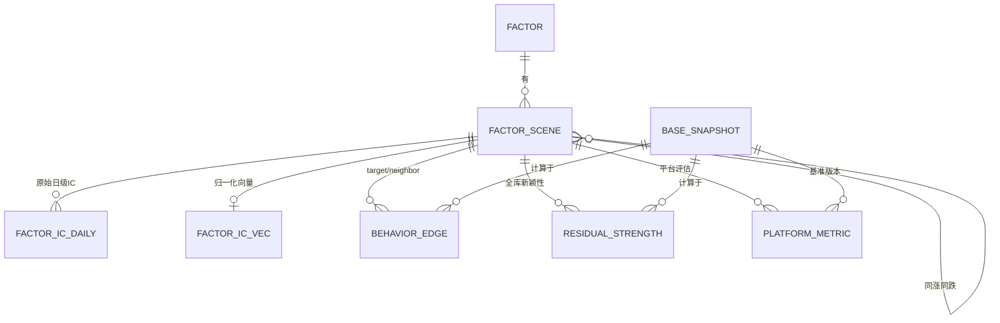

# 数据模型设计：因子行为空间与双基准冗余

> 状态：设计稿 v1（2026-08-18），对齐 [problem-definition.md](./problem-definition.md)
> 三条原则：场景是原子单位，因子是聚合视图；冗余是“因子 × 场景 × 基准空间”的属性；原始真值落库，派生结果可重算。
> 环节分工：实验前只做构造审查（因子写法 + 算子借鉴），不做冗余检索；冗余判定统一在实验后收紧。

## 1. 核心对象

### factor（已有 `factors` 表）

- 一个 `.h` 因子实现，`xname` 主键。
- 只保留因子自身属性：formula、status、quality、`latest_*` 聚合值。
- 不做行为冗余的载体，行为全部下沉到 scene 层。

### iteration suggestion / factor lineage（v18）

建议和血缘是两类实体，不再共用 `iterations`：

- `iteration_suggestions`：因子节点上的待接续建议，状态 `open -> in_progress -> realized/abandoned`。它只记录“从该因子建议做什么”，不保存 target/outcome/icir。
- `factor_lineage_edges`：已存在因子之间的真实 derivation DAG，是 target/outcome/icir 的唯一事实。边类型区分 `iteration / repair / operator_application / manual / reseed`，并保留 `suggestion_id / idea_id / op_id / evidence`。
  - `confidence` 区分来源等级：`observed`（状态机归档）、`declared`（run/operator contract 明确声明）、`inferred`（历史文本精确回填，仅供画像和审计，不与 observed 混同）。
- `factor_lineage_paths`：传递闭包，包含 depth-0 self path，用于 ancestor/descendant 查询。
- `factor_lineage_nodes`：单因子派生画像，包括 direct parent/child 数、primary root、深度、后代规模、dead_end 后代数、open suggestion 数。
- `factor_lineage_branches`：root 视角分支画像，包括成员数、最大深度、evaluated/dead_end 数、open 建议数、realized 边数。

v18 迁移原样复制 suggestion id，只有 realized 且非自指的旧行才生成血缘边。v19 物理删除旧 `iterations` 表，并替换为只读兼容 view。v20 把 `iteration_suggestions` 收敛为纯节点待办：realize 后只有 `factor_lineage_edges` 保存 target/outcome/icir，建议表不再重复。

### scene（新表 `factor_scenes`）

- 原子单位：`(factor_xname, symbol, variant, y_horizon)`。
- `variant` = 平台参数化名（现 `freq` 字段），不是时间频率。
- 行为相关、平台 restest、冗余边都以 scene 为锚。
- 现有 `factor_ic_daily` / `factor_ic_vec` / `factor_ic_vec_meta` 保留为 scene 的原始与派生数据，增加 `scene_id` 关联。

### base_snapshot（新表）

- 记录一次“基底空间”快照，本地与平台共用一张表，用 `space` 区分：
  - `local`：当时 `evaluated` 因子集合（成员 JSON / hash）。
  - `platform`：平台参照库版本（如 `qyshen/0727pass_v3`，含因子清单 hash）。
- 目的：历史冗余结论可复现，库增长或平台升级后旧结论不漂移。

### behavior_edge（新表）

- 本地空间 pairwise 行为相关结果。
- 字段：`target_scene_id`、`neighbor_scene_id`、`pearson`、`n_overlap`、时间窗、`base_snapshot_id`、`computed_at`。
- 只存精确复核后的边；ANN 只做粗筛，不落库（或仅落 coarse 值用于审计）。

### residual_strength（新表）

- 本地空间“相对全库基底的新颖性”标量。
- 字段：`scene_id`、`base_snapshot_id`、`strength`、`n_base`、`base_factors`（JSON）、岭参数、`computed_at`。

### platform_metric（新表）

- 平台参照空间场景级评估。
- 字段：`scene_id`、`base_version_id`、`eval_ts`、`R2_X`、`res_IC`、`n`、`source_eval_id`。
- `factors.latest_*` 只作物化聚合，完整明细以本表为准。

## 2. 关系



## 3. 两个空间的查询路径

本地空间：

```text
pairwise：scene → ANN 粗筛 → 精确复核 → behavior_edge
全库新颖：scene → residual 岭回归 → residual_strength
因子级：  对场景聚合（如 max |pearson|）
```

平台空间：

```text
scene × base_version → R2_X / res_IC → platform_metric
因子级：latest_* 取主力场景聚合，完整明细在 platform_metric
```

## 4. 与现状的迁移路径

- 不推倒 `factors` / `factor_evals` / `lessons`；`iterations` 已由 v19 退役为只读兼容视图。
- `freq` 语义保留，新增 `factor_scenes` 表并回填现有 60 行场景数据。
- `behavior_edges` / `residual_strength` 由一次全量 refresh 对 evaluated 因子重算。
- `platform_metric` 从 `factor_evals.eval_metrics` JSON 回填现有 restest 明细。
- 新表都是派生数据，可删可重算；`factors` 与 `factor_ic_daily` 是单一真相源。

## 5. 数据生命周期

| 时机 | 动作 |
|---|---|
| 候选/写因子 | 只做构造审查（写法、框架规范、算子借鉴），不查库做冗余 |
| `check_done` | `factor_ic_refresh` 写 `factor_ic_daily/vec/meta`，因子进入行为空间 |
| `assess/persist` | 写 `platform_metric`；对受影响场景重算 `behavior_edges` / `residual_strength` |
| R1 选题 | 只读 selection 状态；候选阶段不消费冗余边 |
| 基底变化（新 evaluated） | 旧结果保留 `base_snapshot_id`，新查询用新 snapshot |
