# Research Loop 数据交互全景

本文梳理当前量化研究主链中所有会与数据打交道的阶段，以及每个阶段读取/写入的具体内容。范围覆盖 `research-loop → cog-protocol → run-factor-agent → assess → 入库` 的完整流程。

这里的“数据”分为四类：

1. **因子库**：`data/factors.db`
2. **市场/探针数据**：本地 `.xy` 缓存与平台历史行情
3. **平台评估产物**：IC 结果、Ridge-SVD 结果、失败诊断
4. **run state**：一次研究循环的执行状态与中间证据

## 1. 数据存储与角色

| 存储/系统 | 路径或标识 | 角色 |
|---|---|---|
| 因子库 | `data/factors.db` | 因子、评估、lesson、operator、iteration、coverage、IC 向量的持久库 |
| run state | `~/.quant-runs/<run_id>/state.json` | 单轮研究的状态机、候选 spec、平台证据、verdict、持久化结果 |
| XY 缓存 | `/home/lgao/tmp/factor-vec-cache` | 平台 `dailyX/*.xy` 本地缓存，用于探针调查与 IC 向量刷新 |
| 因子源码 | `factors/*.h` | FeedIndicator 因子实现，含 frontmatter 元数据 |
| 量化平台 | featuretool `default_test` | 提交因子、运行 IC DAG、运行 Ridge-SVD restest、下载结果 |
| 平台临时产物 | `/tmp/research-run-*`、`/tmp/ridge_svd.tar.gz` | check/restest 下载与解析的临时目录 |
| 认知中间文件 | `.tmp/assumptions.json` | assumption 抽取结果，供 evidence investigation 使用 |

## 2. 主链总览

```mermaid
flowchart LR
  A["0. run init<br/>写 run state"] --> B["1. R1 选研究对象<br/>读因子库"]
  B --> C["2. Factor Profile<br/>读因子库+IC历史+lesson"]
  C --> D["3. Assumption<br/>读 construction view"]
  D --> E["4. Evidence Investigation<br/>读 XY 缓存/原始探针"]
  E --> F["5. R2/R3 查重<br/>读 operators+因子实现+dead_end"]
  F --> G["6. 候选生成与持久化<br/>写 ideas+run state"]
  G --> H["7. 写因子/submit<br/>写 factors/*.h+平台任务"]
  H --> I["8. check<br/>下载 IC 产物写 run state"]
  I --> J["9. restest<br/>下载 Ridge-SVD 写 run state"]
  J --> K["10. assess/persist<br/>写 factors/evals/lessons"]
  K --> L["11. iteration 与收尾<br/>写 iteration_suggestions+run state"]
```

## 3. 逐阶段数据交互

### 3.0 run 初始化

**数据源**

- `~/.quant-runs/<run_id>/state.json`

**读取**

- 新 run 尚无历史 state。

**写入**

- `run_id`
- `run_dir`
- `status=running`
- `idea`
- `factors` 骨架
- `started_at`

### 3.1 R1 选择 Research Object

**数据源**

- `data/factors.db`

**读取**

从 `factors` 表读取：

- `xname`
- `status`
- `created_ts`
- `latest_icir`
- `latest_r2_x`
- `latest_res_ic`

从 `factor_research_state` 读取：

- `research_exhaustion_score`
- `last_selected_ts`
- `last_outcome`
- `times_selected`

同时读取：

- idea/factor link 与 open idea
- lineage 分支覆盖情况
- 同分支 dead_end 密度

**写入**

- 本阶段主要是读库与打分。
- 认知尝试结束后，通过 derived table 更新 `factor_research_state` 的尝试次数、产出类型和 exhaustion 状态。

### 3.2 Factor Profile 构造

**数据源**

- `data/factors.db`

**读取**

从 `factors` 表读取：

- `formula_text`
- `operator_chain`
- `field_bindings`
- `params`
- `status`
- `latest_ic`
- `latest_icir`
- `latest_sharpe`
- `latest_rank_ic`
- identity 信息

从 `factor_ic_daily` 读取：

- feed/horizon IC 分布
- 按天样本数
- 平均/最小/最大 IC

从 `lessons` 读取：

- dead_end/success/iteration lesson
- lesson evidence

从 `factor_lineage_edges` 读取同父节点的 siblings：

- xname
- IC/ICIR
- formula 摘要

**写入**

- 不写 DB。
- 只在内存中生成三个视图：
  - `construction_view`
  - `evidence_view`
  - `provenance`

**注意**

`factor_profile` 的 `evidence_view.latest_metrics` 已包含 `latest_r2_x/latest_res_ic`。

### 3.3 Assumption 抽取

**数据源**

- Factor Profile 的 `construction_view`
- `TRADING_WORLD_MODEL.md`

**读取**

- 因子构造公式
- operator chain
- field bindings
- params
- 世界模型中的市场机制说明

刻意不读：

- IC/ICIR
- 收益表现
- dead_end lesson

这样可以避免根据结果反向编造假设。

**写入**

- 主会话将 assumptions 数组写入 `.tmp/assumptions.json`。

### 3.4 Evidence Investigation

**数据源**

- `/home/lgao/tmp/factor-vec-cache/<Factor>/dailyX/daily-YYYYMMDD.xy`

**读取的原始探针**

- `RawBidSize0..4`
- `RawAskSize0..4`
- `RawBidPrice0`
- `RawAskPrice0`
- `RawOI`
- `RawTotalVolume`

**读取的 Y**

- AG `PriceMid` future return
- `@1/@5/@10/@60/@300` 秒

**计算内容**

1. 将 14 个原始探针按 `receive_time` JOIN。
2. 派生约 89 个机制维度，包括：
   - mid/spread/price step
   - top-book imbalance 与差分
   - depth thickness/entropy/centroid
   - tempo/burst/run length
   - event proxy
   - Hawkes intensity
   - OI/volume 变化
3. 对每条 assumption：
   - 匹配 held_equal 与 collapsed 维度
   - 按 held 维度分 bin
   - 计算 bin 内 collapsed 维度对 Y 的条件 IC
4. 输出 `SUPPORTS / CONTRADICTS / UNCLEAR`。

**写入**

- 不写因子库。
- 输出 evidence card 给后续 adjudicator 与主会话。

### 3.5 R2/R3 查重与算子闭包检查

**数据源**

- `operators`
- `operator_capability_index`
- `operator_capability_vec`
- `factors`
- `factor_operator_usage`
- `lessons`
- 因子公式/语义 embedding

**R2 读取**

- 现有 operator capability
- temporal/observable/carrier 兼容性
- supported distinction 与 operator 的语义匹配

**R3 读取**

- semantic channel
- structural channel
- field/channel
- operator/channel
- lineage/channel
- dead_end warning

**写入**

- 查重阶段不写库。
- 只有 G4 判定 `NEW_OPERATOR_NEEDED + NOVEL` 后才进入注册。

### 3.6 Operator 注册

**数据源**

- `operators` 表

**读取**

- 查重结果与 contract

**写入**

- `op_id`
- `name`
- `definition`
- `input_roles`
- `abstract_structure`
- `direction_property`
- `source`
- `source_ref`

### 3.7 候选生成与持久化

**数据源**

- operator contract 或 repair contract
- `ideas`
- `iteration_suggestions`
- `factor_lineage_edges`
- run state
- 可选：coverage、最近 lesson、semantic neighbors

**读取**

- operator contract
- preserved/new/forbidden signals
- open iteration suggestion
- 平台能力边界

**写入**

- `persist_idea` 写 `ideas`
- `persist_candidates` 写 run state：
  - factor name
  - formula
  - hypothesis
  - intuition
  - tags
  - params
  - categories
  - status=pending
- 若候选来自 open suggestion，则更新 iteration 状态为 in_progress。

### 3.8 写因子与平台 submit

**数据源**

- `factors/<Name>.h`
- featuretool 平台

**读取**

- write-factor 模板与框架 API
- 候选 spec
- `.h` 中的 class/template 参数

**写入本地**

- `factors/<Name>.h`
- frontmatter：
  - xname
  - class_name
  - formula
  - tags
  - params
  - created_ts
- run state：
  - factor_file
  - status=submitting

**平台交互**

- 上传 `.h`
- 提交 feature class/template name
- categories 转换为 feeds，例如 `["AG"]` → `SHFE-AG,SHFE-AG@1`
- CPU 侧走 **Submit ictest**（原 Submit Feature (test)），创建 test IC DAG
- GPU 侧走 **Submit restest**（原 Submit GPU），并发创建 ridge_svd DAG
- 在线查看统一在 **All results**；主页 Download 列仅保留结果包下载
- CPU ictest 与 GPU restest 默认日期窗口统一为 `20250101~20250630`，保证 IC 与冗余分析同窗口

### 3.9 platform check

**数据源**

- featuretool `default_test`
- `/tmp/research-run-*`
- Airflow 日志

**当前 research-loop / default_test 实际路径**

`platform_check_factor` 调 `factor_check.py run --mode none`。原因是 default_test 产物是平台预计算的 `csv_ic` 结果，本地没有 `dailyX/*.xy` tick 明细可供继续跑 feval/pearson/deep。

平台下载产物为：

- `csv_ic_summary.csv`
- `csv_ic_ts.csv`
- `csv_ic_xcorr.md`
- `csv_ic_xcorr.png`

本地解析字段：

主要读取 `csv_ic_summary.csv`：

- `rank_ic_mean`
- `rank_icir`
- `hit_rate`
- `n_days`
- `zero_rate`
- `active_rate`
- `pearson_nonzero`
- 品种/主力/@1/horizon 分组结果

逐日 IC 时序从 `csv_ic_ts.csv` 读取，但会作为大字段外置到 evidence 文件。失败时读取：

- compile error
- runtime crash/error
- Airflow root task
- task locus
- exit code
- cause text
- stderr/stdout tail

**写入**

- run state：
  - `failure_layer`
  - `evidence.eval_metrics`
  - `evidence.stdout_tail`
  - diagnosis
  - retry trace
- 大字段外置到：
  - `~/.quant-runs/<run_id>/<xname>_evidence.json`

此阶段不写 `factors` 表。

**feval 7 维路径**

`factor_check.py` 仍保留 `--mode feval/full`，默认 CLI mode 也是 `feval`。当本地存在 `dailyX/*.xy` 时，会生成：

- `screening.csv`
- `session_ic.csv`
- `vol_regime_ic.csv`
- `zero_analysis.csv`
- `train_test.csv`
- quintile bucket 结果
- `decision_summary.csv`

[core/metrics.py](/home/lgao/work/factor-autoloop/core/metrics.py) 会解析这些产物：

- `core_metrics.session_ic`
- `core_metrics.vol_regime`
- `core_metrics.zero`
- `core_metrics.train_test`
- factor-level KEEP/WATCH/REJECT
- `failure_reasons`

`bucket_analysis_summary.csv` 中的可交易性字段也会被解析：

- `avg_turnover_per_day`
- `sharpe_net_8bps`
- `sharpe_net_16bps`
- `veto3_cost_double`
- `capacity_risk`

但当前 `default_test --mode none` 分支不会生成这些文件，因此这些字段在当前 research-loop 证据中为空。

### 3.10 restest

**数据源**

- featuretool `default_test`
- 平台固定参照库 `qyshen/0727pass_v3`

**交互内容**

将新因子提交 Ridge-SVD，与 AG/AU 72 个既有因子比较。

2026-08-20 起 ridge_svd 唯一入口是 GPU 版 **Submit restest**：

- 表单含 `alpha / lib_key / n_workers(默认 12) / transform_sweep`，不再有 mode/Feeds/日期
- 日期固定半年 `20250101~20250630`，Feeds 由 lib_key 决定
- 平台只输出 `R2_X + res_IC`，冗余判定用 `R2_X>0.8 且 |res_IC|<0.01`
- CPU 版 restest / restest_1 从导航隐藏（历史 URL 仍可访问），新链路一律走 GPU
- GPU csv_ic 模式已移除，IC 分析走 CPU Submit ictest

**下载字段**

每个 `x_col × horizon` 输出：

- `R2_X`
- `res_IC`
- `n`

**写入**

先写 run state：

- `evidence.ridge_svd`：完整 metrics 数组
- `evidence.ridge_svd_agg`：主力场景聚合值

此阶段仍不写因子库；assess commit 时才写 DB。

**并发约束**

restest 提交的“取 formkey → POST → 确认任务出现”临界区使用跨进程文件锁串行化，避免多个 MCP worker 共享 featuretool session 时 POST 静默失败。

### 3.11 assess 与持久化

#### prepare

**读取**

- run state
- `.h` 文件
- hypothesis/argument chain
- eval metrics
- restest metrics

**写入**

- `factors` 表 draft 占位
- formula tags
- anchor/embedding

#### commit

**读取**

- IC/ICIR/zero rate
- horizon IC
- restest：
  - `R2_X`
  - `res_IC`
- 强弱点与迭代建议

**写入 `factors`**

- `status`
- `latest_ic`
- `latest_icir`
- `latest_sharpe`
- `latest_rank_ic`
- `latest_r2_x`
- `latest_res_ic`

**写入其他表**

- `factor_evals`
  - eval metrics
  - conditional returns
  - ridge_svd 明细保留在 `eval_metrics` JSON
- `lessons`
  - success pattern 或 dead_end lesson
- idea support score

**写 run state**

- `verdict`
- `persisted`
- lesson id
- persisted status

### 3.12 iteration 与 run 收尾

**数据源**

- `iteration_suggestions`
- `factor_lineage_edges` / `factor_lineage_paths`
- `ideas`
- run state

**读取**

- 源因子与目标因子 ICIR
- suggestion 状态
- `hypothesis_get` 输出：
  - support_score
  - evaluated_factor_count
  - necessity_grade

**写入**

- `iteration_open` 写 suggestion
- `iteration_realize` 写目标因子、icir_delta，并在 `factor_lineage_edges` 生成真实血缘边；随后重建 `factor_lineage_paths/nodes`
- run state 写：
  - idea support summary
  - idea verdict/conclusion
  - status=done
  - finished_at

## 4. IC 向量刷新链

`factor_ic_refresh` 是研究主链之外的重要维护步骤。它决定后续 `factor_ic_correlate`、`coverage_map` 的质量。

流程：

1. 从平台下载因子 `dailyX/*.xy`
2. 写入 `/home/lgao/tmp/factor-vec-cache`
3. 对每个 `(factor, symbol, freq, y_horizon)` 按日计算 IC
4. 写 `factor_ic_daily`
5. 写 `factor_ic_vec`
6. 写 `factor_ic_vec_meta`

之后可以：

- 查询 IC 行为相似因子
- 计算相对既有基底的新颖性
- 生成 coverage map
- 识别预测行为同涨同跌的真冗余

## 5. 数据权限分层

| 阶段/agent | 是否访问因子库 | 原因 |
|---|---:|---|
| R1 选择对象 | 是 | 需要全库覆盖、研究状态、冗余画像 |
| Factor Profile | 是 | 需要构造、IC 历史、lesson、siblings |
| assumption-extractor | 否，只读 construction view | 防止结果泄漏和反向合理化 |
| evidence investigation | 否，不查因子库 | 直接读逐样本探针与 Y |
| R2/R3 | 是，走统一检索 | 查 operator 闭包和历史实现 |
| operator inventor 早期 | 否 | 防止历史因子锚定 |
| candidate design | 应该读，但目前不是强制 | 需要库地形图，避免语义新但数值冗余 |
| run-factor-agent | 否 | 只负责忠实执行 write/submit/check/restest |
| assess/persist | 是 | 最终写入因子库与 lesson |

## 6. 当前信息断点与改进方向

### 6.1 `factor_profile` 丢失 restest 画像（已修复）

R1 能看到：

- `latest_r2_x`
- `latest_res_ic`

旧版 `factor_profile.evidence_view.latest_metrics` 只包含：

- ic
- icir
- sharpe
- rank_ic

后续 minimal repair/operator invention 因此可能不知道原对象死于 X 空间冗余。

现已修复：`evidence_view.latest_metrics` 会输出：

- `r2_x`
- `res_ic`

### 6.1a 多重检验计数未进入评估卡（已修复）

`platform_check_factor` 现在会在 check_done 后查询因子库，并把以下上下文写入
`state.factors[i].evidence.eval_metrics.research_context`：

- `lineage_prior_attempt_count`
- `lineage_attempt_count_including_current_batch`
- `current_batch_size`

计数口径：已入库的 `evaluated/dead_end/failed` 因子为历史尝试；当前 run 内全部候选计入当前批次。`draft` 不计入历史尝试。查询失败时写入 `available=false`，不阻塞平台 check 主链路。

### 6.2 候选设计前缺少强制 library briefing

当前工具已经有：

- `factor_detail`
- `factor_semantic_search`
- `factor_ic_correlate`
- `coverage_map`
- `coverage_gaps`
- `iteration_list_open`
- `factor_recent_lessons`
- `factor_residual_ic_strength`

但候选设计阶段没有强制统一调用。结果是模型可能只依赖 operator contract 生成语义相近的多个绑定，直到 restest 才发现数值空间冗余。

建议新增 mandatory library briefing，至少包含：

- semantic neighbors
- behavioral neighbors
- neighbors 的 restest 画像
- coverage thin/hot/stale areas
- open iteration suggestions
- dead_end warnings

每个候选应显式输出：

- `library_neighbors`
- `why_not_redundant`
- `binding_delta`
- `expected_marginal_signal`
- `kill_criterion`

### 6.3 语义新颖不等于边际贡献

一个新 operator 可以在语义层成立，但具体绑定后仍可能落在既有因子的线性张成空间中。典型信号是：

- rank IC 强
- ICIR 高
- `R2_X` 高
- `res_IC` 接近 0

因此候选设计阶段必须同时看：

- 机制新颖性
- 与既有因子的行为相似性
- X 空间冗余度
- 覆盖空白

## 7. 关键不变量

1. **原始行情不直接进入 LLM 上下文**
   LLM 看到的是程序化聚合后的 evidence card、IC、restest、lesson 与诊断。

2. **平台证据先落 run state，再由 assess 入因子库**
   check/restest 阶段不直接写 `factors` 表。

3. **restest 明细不可丢**
   主力场景聚合写入 `factors.latest_*`，完整 `x_col × horizon` 明细保留在 `factor_evals.eval_metrics`。

4. **执行层不自由查库**
   `run-factor-agent` 只做实现、提交、检查、restest 和 state 写入，避免参考历史因子后偏离 contract。

5. **认知早期隔离表现数据**
   assumption 阶段只看 construction，防止根据 IC 反推假设。
